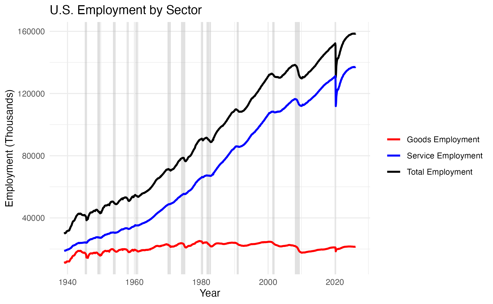
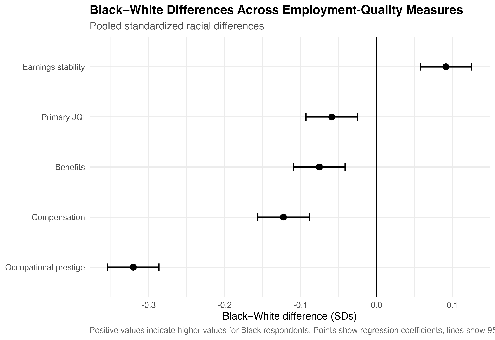
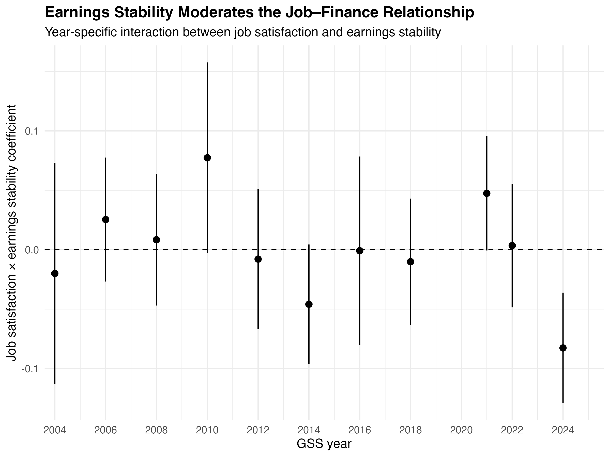
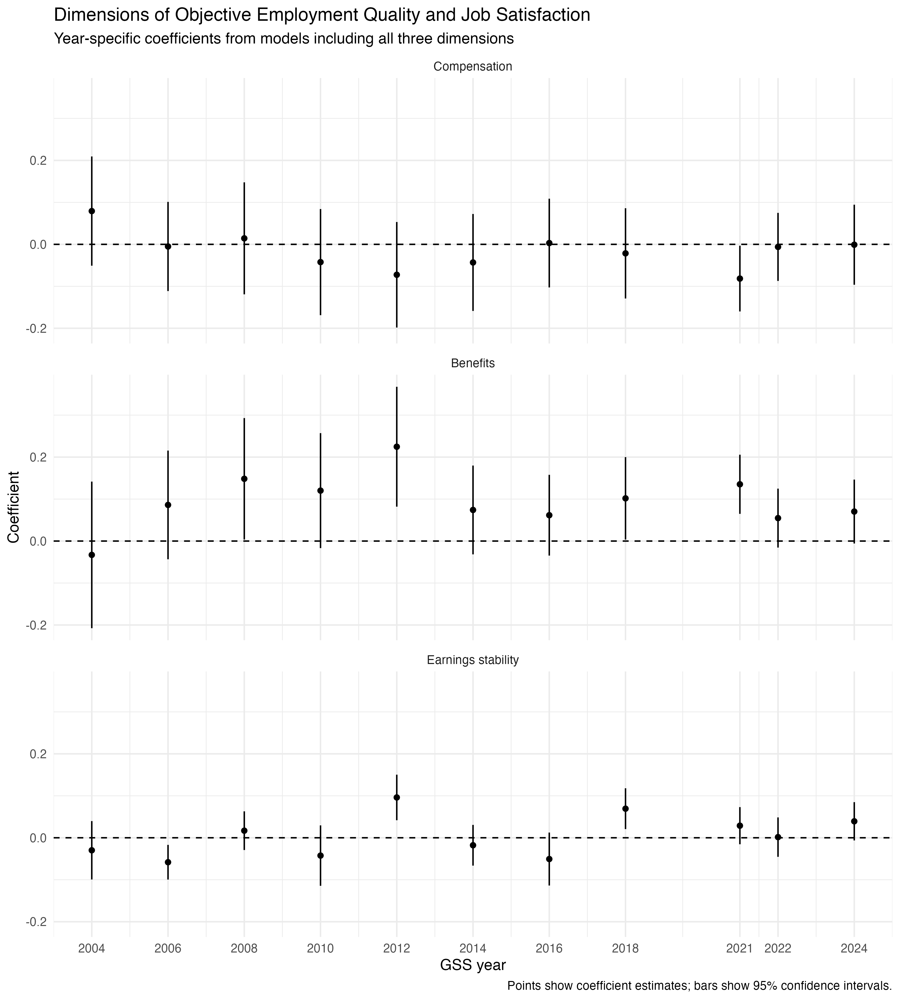
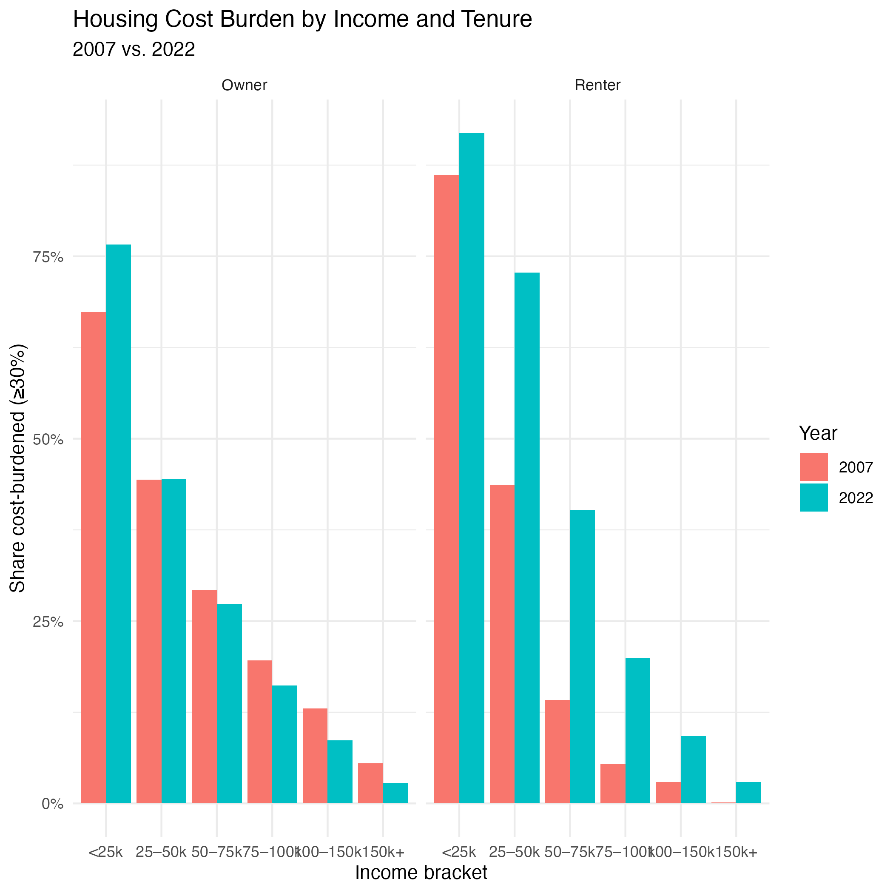

```{r setup, include = FALSE}
# set global options
knitr::opts_chunk$set(echo = FALSE, message = FALSE, warning = FALSE, results = FALSE)
# Set the working directory to be the project directory (aka root or top-level directory)
knitr::opts_knit$set(root.dir = here:: here())
```

```{r Package Import, include=FALSE}
library(here)
library(knitr)
library(devtools)
library(tidyverse)
library(rticles)
library(bookdown)
library(kableExtra)
library(ggthemes)
library(stargazer)
library(pander)
```

## Introduction: The Anatomy of a "Non-Crisis"

An interview last January with two Presidents of the San Francisco and Richmond Federal Reserve Banks, Mary Daly and Tom Barkin, respectively, highlighted the ways in which measured caution shapes our perspective on the outlook on the economy. Both spoke to the ways that expectations over inflation should not over-index our concerns about the economy heading into (or not heading into) a recession. Their overarching aim is to help highlight the resilience of the economy in order to highlight that while there might be distinct features of what is going on in the contemporary moment, the uncertainty that is currently facing the economy in terms of inflation, AI investment, and the recovery of American markets in the era following the 2020 coronavirus pandemic in many ways could be understood to highlight the strength of the economy rather than its distance towards increased precariousness. President Barkin states:

> "I keep saying if you’re going to predict a recession, you’re going to be right eventually. But I’m not sure that means you’re a good forecaster. It just means you’re a stubborn forecaster. In our working lifetimes, the recessions have not come out of a gradual economy drifting down into recession. They’ve come out of sudden issues like the pandemic, like Lehman Brothers, like 9/11, like the Iraq war. So I just make that point, which is all of the forecasting that suggests we’re just going to drift into recession, that would be different from the way it’s worked over the last 40 or 50 years.

What this implies though is that the measures used to understand the broader macro-economy are time invariant; that inflation, even as it hovers around 3.4%, which is about 1.5% above the Federal Reserve target rate, is nonetheless still within the bounds of what we might understand a traditional economy to look like. Moreover, that we have an unemployment rate of 4.2%, a relatively low rate, also indicates stability rather than precarity at the macro-level.

But this kind of narrative of American resilience tends to obscure some other factors that seem to counteract this kind of framework. For one (as Presidents Daly and Barkin note), the years following the pandemic have seen a dramatic decline in consumer sentiment. Americans are broadly pessimistic about their financial lives and their financial futures. Beyond that, within the context of consumption, according to the Financial Times, the top 10% of US earners account for half of all consumer spending, suggesting a legitimate and notable shift in terms of the relationship between financial indicators and financial behavior.

How we talk about economic retrenchment, I argue, is downstream from the fact that changes in the American Political Economy have meant that what we don't consider crises paper over forms of risk-shifting [@hacker2004] that are occurring at faster and faster rates. Recent work by Dara Strolovitch makes the claim that:

> "the very notion of economic crisis relies on assumptions and practices that reflect, reproduce, and constitute prevailing attitudes and normative expectations about racialized and gendered labor and economic inequalities." [@strolovitch2023]

This astute point, I argue, is being exacerbated and expanded by the fact that as wealth concentrates in a more dramatic fashion, it ironically becomes routinized, expanding the bounds of what she calls a "non-crisis" [@strolovitch2023].

The types of financial cushion offered by whiteness and masculinity are increasingly slipping as social forces, instead giving way to to an ever narrowing group of people unaffected by what Hacker calls "risk contagion" that is being spread to more people up and down the income distribution in disturbing and sometimes surprising combinations [@hacker2004]. This is not to say that the financial lives Black communities and other people of color are not still shaped by dispossession but that the kinds of social protection that we anticipate will protect white people and men, particularly through the labor market, are harder to sustain as the ability to stay out of financial precarity strictly from wages becomes less and less of a common experience in the American context.

The remarks from Presidents Daly and Barkin are helpful inasmuch as they argue for a cautious approach to understanding the macro-economy that doesn't over-index on the frustrations that people are going through in the here and now. But I would argue that this approach is problematic, not just because it shortchanges the ways that people lower on the income distribution experience their financial lives, but because it under-emphasizes the ways in which our measures for understanding the macro-economy are themselves politically constructed.

This paper argues that changes in the economy, particularly those dealing with increased concentration of wealth, have shifted the utility of our tools for understanding macro-economic health. This in turn has meant that we are slotting in aggregate economic output and activity for economic pain in ways that means that a normal, routinized view of the economy shortchanges and marginalizes the economic pain of the working class.

I argue that once we front-load substantive measures that focus on economic pain at the household and community level rather than macroeconomic resilience at the aggregate level or the level of the multinational firm, we begin to see that the information something like a declaration of recession is supposed to give us is largely irrelevant to a larger and larger proportion of Americans. I theorize this casualization of crisis as "the endemic recession."

# Proceed with Caution

To understand what is meant by an endemic recession, it is helpful to start by thinking about what is meant by macro-economic health. What is the use value of knowing a country is in recession? Well, for one, it highlights where a country is within a basic business cycle.

As most economists will attest, recessions are retrospective vehicles. They are indications of whether the country has been through the last stage of a business cycle that has been characterized by expansion, then a sputtering into slow down (often referred to as a peak), a low point (called a trough), a period of speeding up then blowing past its prior point of initial slowing down (called a recovery), until it finally begins to expand again. Implicit in this configuration is the sense that if you look at major macroeconomic outcomes, the expectation is overtime growth in a secular fashion that contains a cycle within it.

@fig-history demonstrates this phenomenon. While each shaded region representing a recession shows a dip in growth, the overall trajectory of growth is upward. We can also see in this chart a broader story of manufacturing job loss as the Goods Employment is on a steady downturn. So even as there is a secular increase in the overall number of jobs which should reflect a broader resilience against economic downturn, this resilience isn't reflected at the sectoral level.

{#fig-history}

Meanwhile, this has occurred concurrently with a massive spike in the unequal concentration of wealth in the country. Elon Musk, the current richest man on the Forbes top 100 List of Wealthiest Americans, has a net worth that is 135 times greater than the richest man on the list in 1982, Daniel Ludwig. But taking the highest wealth-earner together with the ways that aggregate output hides sector-level employment, while these measures don't cancel each other out, they do highlight that aggregate output as an estimand with respect to economic health is not as stable as we might initially think.

Much of the coverage of economic news during the run-up to the 2024 election was covered through the lens of the so-called "vibecession" which articulated a discordance between strong outcomes in terms of the economy against a backdrop of declining consumer sentiment and frustration from American voters over the Biden Administration's handling of economic affairs.

This kind of hand-wringing only makes sense if the ways that we're considering economic health are tied not to the ways that people are responding to shifts in labor markets and consumer spending but rather are tied to the ways that they are or are not tying their behavior to traditional measures of economic success.

But this is in many ways reflects how we are primed to think about economic news. The media narrative about Biden's economic policy was largely about how to understand the discordance between a "strong" economy and a "misguided" public rather than thinking through what features of the economy might not reflect people's lived reality who were in fact in a period of prolonged dispossession \[cite\]. Part of why this happens is because dispossession, here referring to a kind of broader economic pain that becomes stretched out over a long period of time, is not a conventional way of thinking about economic malaise. Instead, our sense of economic downturns are normally tied to cataclysmic moments or episodes. Recessions, as stated above, are often demarcated by the onset of a massive crisis such as a war or the defaulting of a major part of the economy a la the Great Recession. And in this way, Barkan is correct: if by economic downturns, we are not referring to the kind of major, sort-of exogenous shock that precipitates a major, yet sudden drop in the population enrolled in the labor market, then perhaps we should be thinking about recessions as occurring in ways that are distinct from how they have historically occurred.

For example, as Kathleen Thelen argues, unemployment as a measure of economic health is increasingly ineffective because of the rise of contingent labor in the American labor market \[cite\]. To suggest that simply having a job is concomitant to a broader economic success story or even a story of resilience is mistaken not just because of consumer sentiment but also because if we take the long view and tie wages to hours worked, people are doing more work for less money and paying more and more for basic needs. Put another way, as the American political economy changes, so too will the relationship between the political economy and political behavior.

This brings me to the spirit of this paper: by looking at three distinct factors that highlight the relationship between economic outcomes and political attitudes including housing burden, job quality, and political efficacy, I provide an overview of the way that the post-pandemic years of the United States have demonstrated surprising and notable shifts in terms of these two factors. This shifting relationship, while not necessarily beginning at the outset of the pandemic, highlight the ways in which macro-economic health is not necessarily best served by using and relying on the same measures that have been used in service of maintaining an economic and political status quo. While there are major and intuitive benefits to economic policymakers not rushing to declare a broader state of economic emergency, if it is the case that most people are *already living in one*, our understanding of just what constitutes economic crisis and pain needs to be updated and re-examined.

# Political Behavior and Racialized Fissurization

I construct different measures for compensation, benefits, and earnings stability to unpack the different ways that measurement of job satisfaction can mask the very reasons that continue to stay in work while being in school at the same time.

A sharp example of this change in relationship is the nature of work itself. Far from being a simple binaristic outcome in terms of if people do or do not have full-time employment, having a job is a bundle of features, many of which matter in different ways than others. In @fig-racediff_jqi,

{#fig-racediff_jqi}

The Trump Administration's One Big Beautiful Bill represented the largest upward transfer of wealth in the history of the United States. But its coverage largely obscured that fact, focusing instead on Republican unity in passing the legislation in spite of the losses that many rank-and-file Republican voters would face rather than the substantive impacts and world historic implications of the bill. This coverage mirrors many of the other economic victories that Trump has amassed for the top 1% during his second administration: realpolitik and horse-race electioneering took precedence over the ways that those victories shape long-term outcomes for the working class. It can be easy to pin this on corporate media and its increasing desire to monetize views through the medium of feeding into partisan conflict particularly over the last 30 years \[cite\], but doing this under-emphasizes the ways that this type of centrality of the elite driven two-party conflict over the effects of the mass public finds flourish and analogue in the broader macro-economy itself.



This is playing out not just in terms of the expansion of something like debt and housing burden (though those are key players in this story) but in terms of how we understand and adjudicate broader notions of macroeconomic health. While the United States is being driven further into unprecedented levels of financial precarity, it has somehow avoided the dreaded "R" word: recession. This is primarily attributed to both the cautious maneuvering of the Federal Reserve and the paper tiger of AI investment. Both of these factors, I argue, actually highlight the ways in which conceptions of macroeconomic health are increasingly divorced from the financial realities of most Americans.



# Housing Burden Is More than Housing Burden

{#baldwin_housing}

\newpage 
\begin{center}
  \textbf{Works Cited}
\end{center}
